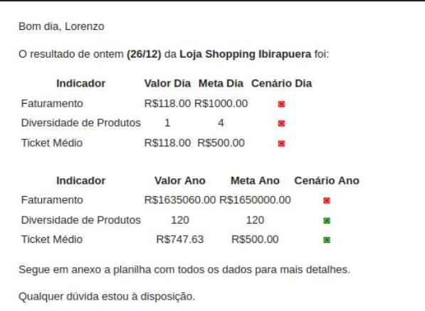
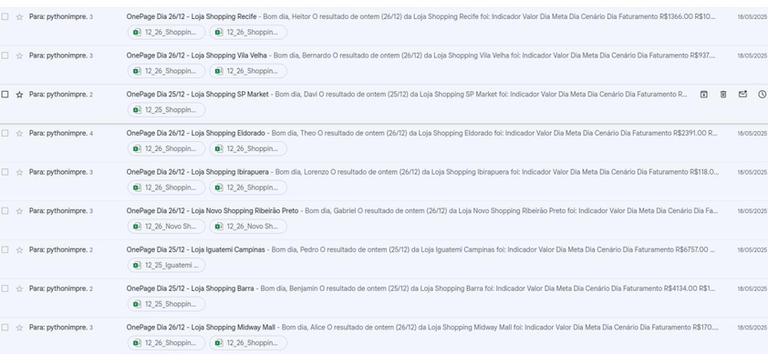

<div align="center">

# Business Indicators Automation

**Automated KPI calculation, target validation, and personalized email reporting.**

A Python automation project designed to transform spreadsheet data into actionable business performance updates.

</div>

<p align="center">
  <strong>Language / Idioma:</strong>
  <a href="./README.md">English</a> |
  <a href="./README.pt-br.md">Português</a>
</p>

---

## Overview

**Business Indicators Automation** is a Python project that processes business data from spreadsheets, calculates key performance indicators (KPIs), evaluates performance against predefined targets, and sends personalized email reports to individual businesses.

The project aims to reduce repetitive manual work involved in analyzing spreadsheets, checking business goals, and communicating performance results.

Instead of manually calculating metrics and preparing separate emails, the automation processes the available data and generates messages containing each business's indicators and their corresponding target status.

This project demonstrates the practical application of Python, data manipulation, business metrics, and email automation to streamline a reporting workflow.

## Key Features

- **Spreadsheet data processing:** reads and processes business information from a spreadsheet.
- **Automated KPI calculation:** calculates revenue, average ticket, and product diversity indicators.
- **Target validation:** evaluates whether the calculated metrics meet their predefined goals.
- **Personalized email generation:** creates individual messages containing the relevant business indicators.
- **Automated email delivery:** sends the generated messages through an SMTP server.
- **Batch processing:** processes information for multiple businesses in a single execution.
- **Execution monitoring:** provides visibility into the number of emails sent.

## Key Performance Indicators

The automation works with three main business indicators.

| KPI | Description |
| --- | --- |
| Revenue | Measures business revenue based on the available spreadsheet data and evaluates it against the corresponding target. |
| Average Ticket | Measures the average value per sale or transaction and compares it with the defined goal. |
| Product Diversity | Evaluates product variety according to the calculation rules implemented in the project. |

Each business receives an email containing its own results, making it easier to understand its performance and identify which targets have been achieved.

The exact formulas, target values, and calculation rules are defined by the project's source code.

## How It Works

The automation follows a straightforward data-processing and communication workflow.

1. **Read the input data:** retrieve business information from the spreadsheet.
2. **Process the records:** organize the data and calculate the required KPIs.
3. **Evaluate performance:** compare the calculated indicators with their corresponding targets.
4. **Generate personalized emails:** prepare a message containing each business's results and target status.
5. **Send the messages:** deliver the emails using SMTP.
6. **Review the execution:** check the execution output to determine how many emails were sent.

This workflow reduces the need for repetitive manual calculations and individual email preparation.

## Technologies

| Technology | Purpose |
| --- | --- |
| Python | Implements the automation workflow and business logic. |
| pandas | Supports spreadsheet data manipulation and processing. |
| smtplib | Sends emails through an SMTP server. |

### Python

Python is the core language used to implement the automation, process the data, calculate the indicators, and coordinate email delivery.

### pandas

pandas is used to work with structured tabular data, making it easier to organize business information and perform the calculations required by the project.

### smtplib

`smtplib` is part of Python's standard library and provides functionality for communicating with SMTP servers to send emails.

It normally does not require a separate installation.

## Project Demonstration

### 1. Personalized KPI Email

The following example demonstrates the email generated for a business.

The message presents the calculated indicators, including revenue, average ticket, and product diversity, and communicates whether the corresponding targets have been achieved.



### 2. Automated Email Delivery

This example demonstrates the email delivery process and the number of messages sent during an execution.

Each message is personalized with the indicators associated with the corresponding business.



## Getting Started

Follow the instructions below to prepare the Python environment.

### Prerequisites

Before running the project, make sure you have:

- Python 3 installed.
- The project's source code.
- The spreadsheet used as input.
- Access to an email account that supports SMTP sending.
- The required SMTP configuration and credentials.

### 1. Clone the Repository

```bash
git clone <repository-url>
cd <repository-folder>
```

Replace the placeholders with the actual repository URL and directory name.

### 2. Create a Virtual Environment

Creating a virtual environment is recommended to keep the project's dependencies isolated.

```bash
python -m venv .venv
```

Activate the environment on Linux or macOS:

```bash
source .venv/bin/activate
```

On Windows PowerShell:

```powershell
.venv\Scripts\Activate.ps1
```

### 3. Install Dependencies

Install pandas:

```bash
python -m pip install pandas
```

If the input spreadsheet is an Excel file, you may also need an appropriate Excel engine, such as `openpyxl`, depending on how the source code reads the file.

```bash
python -m pip install openpyxl
```

The `smtplib` module is included in Python's standard library.

### 4. Configure the Project

Before executing the automation:

1. Make sure the input spreadsheet is available at the path expected by the script.
2. Verify that the spreadsheet contains the columns required by the implementation.
3. Check the KPI calculation rules and target values.
4. Configure the SMTP server, port, sender address, authentication, and recipient information according to your email provider and the project's implementation.
5. Verify that each business is associated with the correct email recipient.

The exact spreadsheet structure, script filename, and configuration method depend on the source code in the repository.

Review the implementation to identify the required values before running the project.

### 5. Run the Automation

Execute the main Python script from the repository directory.

```bash
python <script-name>.py
```

Replace `<script-name>.py` with the actual filename of the project's entry point.

## Security Considerations

Email credentials and other sensitive information should never be committed to a public repository.

Recommended practices include:

- Store credentials in environment variables or an appropriate local configuration file.
- Add local configuration files containing secrets to `.gitignore`.
- Avoid hardcoding email passwords directly into the source code.
- Test the automation with a small dataset and designated test recipients before sending messages to multiple businesses.
- Verify the recipient mapping to prevent business information from being sent to the wrong address.

For email providers that require application-specific passwords or additional SMTP configuration, follow the provider's security requirements.

## Customization

The project can be adapted to different business reporting requirements by modifying the relevant implementation details.

Possible adjustments include:

- Changing the KPI calculation rules.
- Updating target values and performance criteria.
- Adapting the spreadsheet structure.
- Modifying the content and formatting of email messages.
- Updating SMTP configuration and recipient information.

Any changes should be tested with sample data to ensure that the calculations and target evaluations produce the expected results.

## Potential Improvements

The following enhancements could extend the project in future iterations:

- **Input validation:** identify missing, inconsistent, or invalid spreadsheet values.
- **Structured logging:** record processing steps and errors for easier troubleshooting.
- **Delivery failure handling:** distinguish successfully sent emails from failed attempts.
- **Configuration management:** centralize configurable values and credentials.
- **Automated testing:** validate KPI calculations and target evaluation rules.
- **Execution summaries:** provide a clearer overview of processing results.

These are potential improvements rather than claims about existing functionality.

## What I Learned

This project provides practical experience with:

- Python automation and scripting.
- Data processing with pandas.
- Calculating and evaluating business performance indicators.
- Working with spreadsheet-based business data.
- Automating personalized email communication through SMTP.
- Translating business requirements into a repeatable technical workflow.

## License

No license has been specified for this project.

If you intend to distribute the source code for public reuse, consider adding an appropriate `LICENSE` file.

---

<div align="center">

**Business Indicators Automation**

Built with Python and pandas.

</div>
